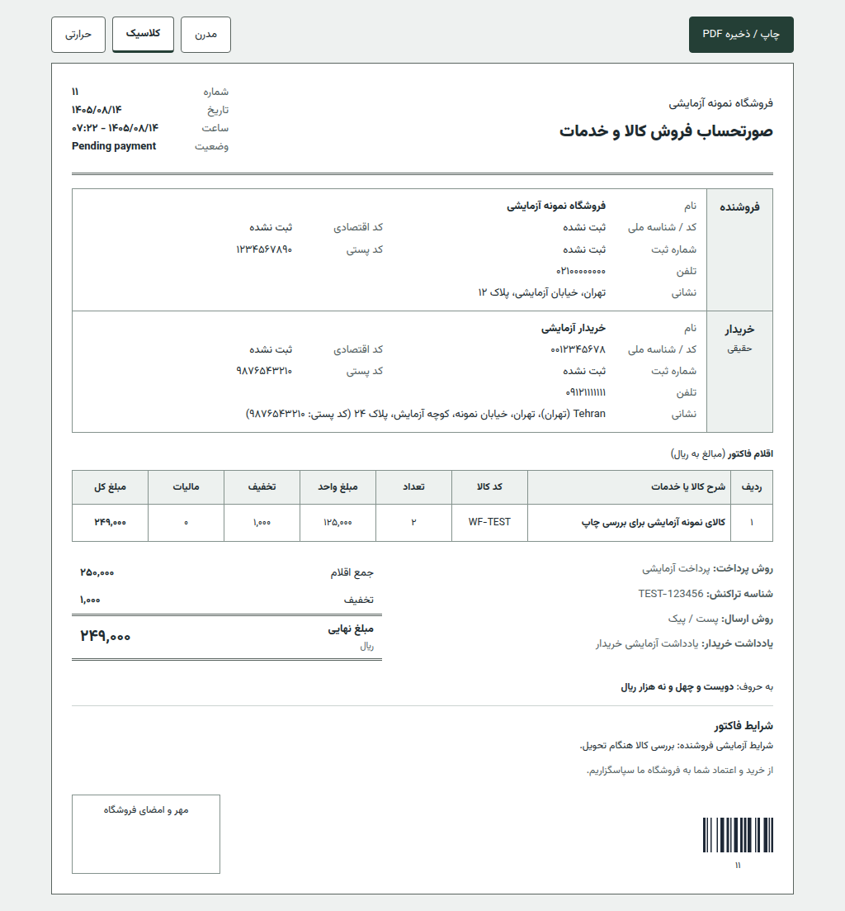
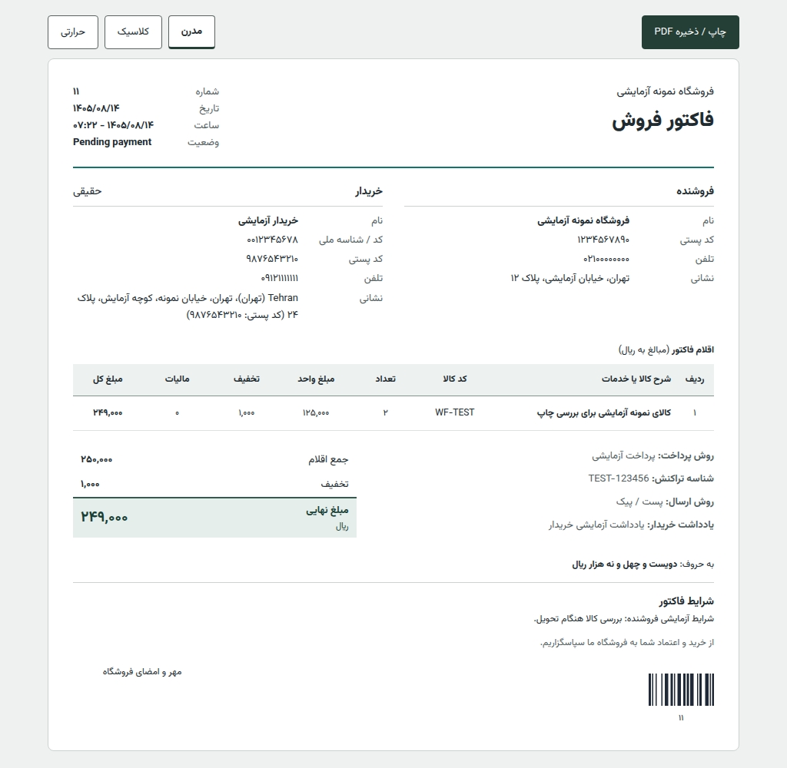

<div align="center">


# فاکتورساز حرفه‌ای ووفاکتور | WooFactor

**سامانه پیشرفته و مدرن صدور و چاپ فاکتور رسمی، رسید فیش‌پرینتر، ارسال پیامک و برچسب پستی مرسوله**

[](https://github.com/Majidygh/woo-factor)
[](https://woocommerce.com/)
[](https://www.php.net/)
[](LICENSE)

[امکانات کلیدی](#-امکانات-و-قابلیت‌های-کلیدی) • [قالب‌های فاکتور](#-معرفی-قالب‌های-فاکتور) • [سامانه پیامک](#-اتصال-به-سامانه‌های-پیامک-کشور) • [Changelog](#-changelog-v214) • [راهنمای نصب](#-راهنمای-نصب)

</div>

---

## 🎨 معرفی قالب‌های فاکتور

ووفاکتور دارای **۳ قالب استاندارد و تفکیک‌شده** با طراحی مدرن و بدون وابستگی خارجی است:

### ۱. قالب رسمی و استاندارد دارایی (Classic Tax Standard)
صورتحساب رسمی فروش کالا و خدمات؛ مجهز به تفکیک اشخاص حقیقی و حقوقی، کد اقتصادی، شناسه ملی، شماره ثبت، تفکیک مالیات و ارزش افزوده، مبالغ به حروف فارسی، مهر رسمی و بارکد خطی سفارش.

<div align="center">
  
</div>

---

### ۲. قالب مدرن
فاکتور فشرده با مشخصات فروشنده و خریدار در دو ستون، جمع نهایی مشخص و نمایش اقلام به صورت خوانا در موبایل. رنگ انتخابی فروشگاه در خط سربرگ استفاده می‌شود تا خوانایی متن به رنگ سفارشی وابسته نباشد. انتخاب ذخیره‌شده قالب در فروشگاه‌های موجود تغییر نمی‌کند.

<div align="center">
  
</div>

---

### ۳. قالب فیش‌پرینتر حرارتی (Thermal 80mm POS Receipt)
طراحی استاندارد برای **دستگاه‌های صدور فیش، پوز فروشگاهی و پرینترهای حرارتی رول کاغذی ۸۰ میلی‌متری**. خروجی فشرده با بارکد سریع و بهینه جهت انبارداری و تحویل سفارش.

<div align="center">
  
</div>

---

## ⚡ امکانات و قابلیت‌های کلیدی

- 🏢 **انتخاب مشتری حقیقی / حقوقی در تسویه حساب**: سوییچ هوشمند فرم پرداخت با فیلدهای تخصصی شرکت‌ها (کد اقتصادی، شناسه ملی، شماره ثبت).
- 📲 **سامانه پیامکی هوشمند الگو محور (Pattern-based)**: اتصال به ۴ وب‌سرویس مطرح کشور (IPPanel/فراز، کاوه‌نگار، ملی‌پیامک، SMS.ir) با ارسال فوری خدماتی.
- 🧾 **قالب فیش‌پرینتر حرارتی ۸۰mm**: خروجی اختصاصی برای پرینترهای صندوق و انبارداری.
- 📮 **برچسب پستی پیشرفته مرسوله (Shipping Label)**: همراه با تفکیک فرستنده و گیرنده، شماره موبایل، بارکد استاندارد و یادداشت مشتری.
- 🛡️ **سازگاری کامل با ووکامرس و HPOS**: پشتیبانی ۱۰۰٪ از High-Performance Order Storage بدون اخطار.
- 📊 **بارکد خطی استاندارد Code 128**: وکتور و سبک بدون نیاز به کتابخانه‌های سنگین خارجی برای اسکن سریع در انبار.
- 🖼️ **آپلودر مستقیم مهر، امضا و لوگوی فروشگاه**: با قابلیت درج خودکار تصویر مهر شفاف (PNG) در فاکتورها.
- 📦 **چاپ گروهی فاکتورها و برچسب‌های پستی**: انتخاب چندین سفارش در مدیریت و دریافت خروجی یکپارچه.
- ✍️ **تبدیل خودکار مبالغ به حروف فارسی**: درج خوانای جمع کل نهایی به حروف فارسی.
- 🔒 **حریم خصوصی و سئو**: اضافه شدن خودکار تگ‌های `noindex, nofollow` برای جلوگیری از ایندکس صفحات فاکتورها در گوگل.
- 🔤 **فونت فارسی و بهینه وزیرمتن (Vazirmatn)**: بدون نیاز به CDN خارجی، ۱۰۰٪ لود محلی سریع.

---

## 📲 اتصال به سامانه‌های پیامک کشور

| سامانه پیامک | متد وب‌سرویس | عبور از بلک‌لیست تبلیغاتی |
| :--- | :--- | :--- |
| **فراز اس‌ام‌اس / IPPanel** | ارسال با پترن (Pattern SMS) | ✅ بله (فوری) |
| **کاوه‌نگار (Kavenegar)** | متد اعتبارسنجی (Lookup) | ✅ بله (فوری) |
| **ملی‌پیامک (Melipayamak)** | وب‌سرویس ارسال الگو (BaseService) | ✅ بله (فوری) |
| **SMS.ir** | وب‌سرویس ارسال سریع (Verify Fast) | ✅ بله (فوری) |

---

## تغییرات نسخه ۲.۴.۰

- بازطراحی قالب مدرن و کلاسیک با چیدمان متفاوت، چاپ کم‌مصرف و نمایش موبایل بدون پیمایش افقی.
- تنظیم قالب کلاسیک (رسمی دارایی) به عنوان قالب پیش‌فرض پرینت و سیستم.
- نمایش مبلغ به حروف، شرایط فروشنده و شناسه تراکنش در هر دو قالب.
- رعایت تنظیمات نمایش کد کالا، مالیات، تخفیف و امضا؛ حذف ادعای تایید مالیاتی از خود فاکتور.
- ساده‌سازی ابزار چاپ و انتخاب قالب. پیش‌نمایش‌های نسخه جدید با داده آزمایشی در `docs/screenshots/` هستند.

## 📋 Changelog (v2.1.4)

- Added manual invoice payment status control (Paid, Unpaid, Proforma, None) and configurable watermark options
- Improved mobile responsiveness across invoice templates, headers, customer cards, summary tables, and preview toolbar
- Enhanced table responsiveness with horizontal scroll container preventing mobile viewport overflow
- Added payment status badges to saved manual invoices archive

### Previous Releases:
- **v2.1.3**: Added lightweight JSON file storage for manual invoices in dedicated folder (`wp-content/uploads/woo-factor/manual-invoices/`), per-item VAT %, SKU column support.

---

## 🚀 راهنمای نصب

### روش اول: دانلود فایل زیپ
فایل آماده **`WooFactor.zip`** را از صفحه انتشار دانلود کرده و از مسیر **افزونه‌ها > افزودن > بارگذاری افزونه** در پیشخوان وردپرس فعال کنید.

### روش دوم: نصب از طریق Git
```bash
cd wp-content/plugins/
git clone https://github.com/Majidygh/WooFactor.git woo-factor
```

---

## 📄 مجوز (License)
این پروژه تحت مجوز **[MIT](LICENSE)** منتشر شده است.

**توسعه یافته توسط [Majidygh](https://github.com/Majidygh)**